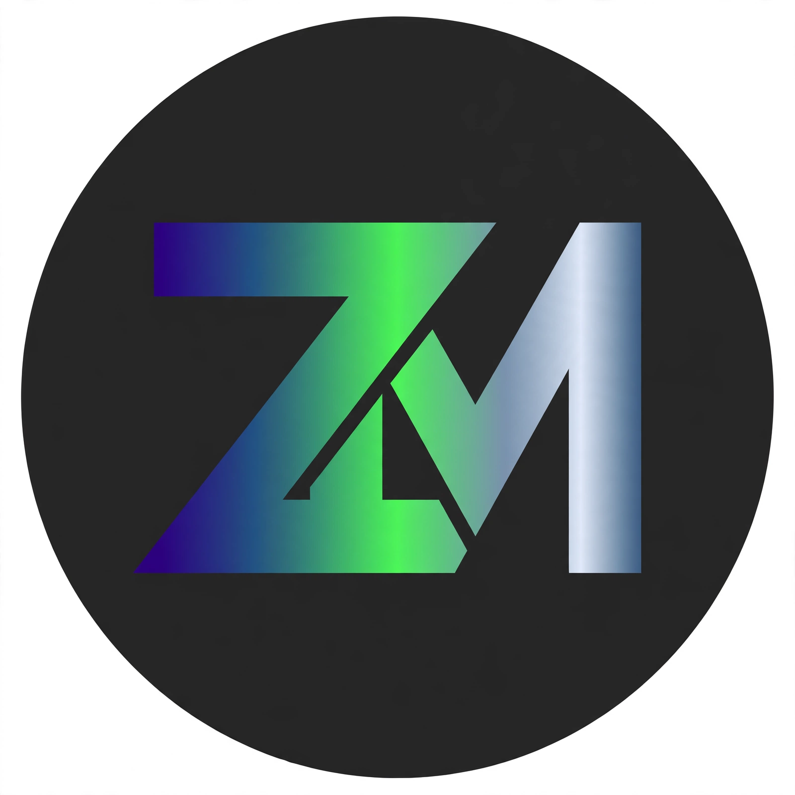

<p align="center">
  
</p>

<h1 align="center">0xzunid.muse.ai</h1>

<p align="center"><strong>0xzunid.muse — zunid + muse, build - zero real money, legit airdrops, tokens, name service - soulbound NFTs on ARC, RobinHood, LitVM, EVM, mainnet-testnet.</strong></p>

<p align="center">
  <a href="https://muse.ai/s/0xzunid-muse-ai-xkm6xkxttxbpwmxe/c3ch1wB7BD8vm46y7rIvWc2GrvMsBF1H20DVuXBBS1w">Project site</a> •
  <a href="https://github.com/0xzunid/0xzunid.muse.ai/pkgs/npm/0xzunid-muse">npm package</a> •
  <a href="https://github.com/users/0xzunid/projects/1">Project board</a> •
  <a href="https://x.com/0xzunid">X @0xzunid</a> •
  <a href="https://muse.ai/s/zunid-name-service-cs6xkxssxfe3xrxe/F8wsYFJLGfCE8ItaPbTzxlvm9r6pY0I_34Ro4d5cR80">Name lookup</a>
</p>

---

## Tokens

All ERC-20, 1,000,000 supply, 18 decimals.

| Token | Chain | Contract |
| --- | --- | --- |
| ZND | ARC testnet | `0x2222703C47f403B34d31351B0C8eA6bB9667Af62` |
| BZND | ARC testnet | `0x942Fc4530335d7658eBfbAFF735e0c34102907fD` |
| RZND | Robinhood Chain testnet | `0x2222703C47f403B34d31351B0C8eA6bB9667Af62` |
| BRZND | Robinhood Chain testnet | `0x942Fc4530335d7658eBfbAFF735e0c34102907fD` |
| LZND | LiteForge testnet | `0x942Fc4530335d7658eBfbAFF735e0c34102907fD` |
| SZND | Sepolia testnet | `0x942Fc4530335d7658eBfbAFF735e0c34102907fD` |

Pools: SimpleAMM — ZND/USDC and RZND/ETH at `0xA995422120eadB0703831b366a24A74dFF580271`, burner pools at `0xc715227626E2855c7bA642bA582bf6A3531AD2D3`.

## Name service

Our own ENS — **ZunidNameService**. Names `0xzunid`, `zunid`, `muse` live on three chains.

| Chain | Registry |
| --- | --- |
| ARC testnet | `0x5F1904E70E4827C796e11740Ba693E4239a0269C` |
| Robinhood Chain testnet | `0x9872A82313ABF5B285431027D31dD94c9DCC029A` |
| LiteForge testnet | `0x2ddF6AF489495450d5128313A5f57DE46fa70f23` |

`0xzunid` resolves to Privy `0x0B22789619E4c035b3A7280C97f3BE87f7A0b981`. `muse` resolves to the burner `0x3a114895Dc50F4163249cC5265Ae42E1b4a74D05`.

## Soulbound name NFTs

**ZunidNameToken** — non-transferable ERC-721, one per name per chain, fully onchain metadata. Like Basenames, but soulbound.

| Chain | Contract |
| --- | --- |
| ARC testnet | `0x7F4115eCc36043146FaAd3984901a07E18ff831c` |
| Robinhood Chain testnet | `0x9575E4e81000478c1ec2f2BCe94f539140FE69DA` |
| LiteForge testnet | `0xb6c0Aaba3d50d834B331778910503C1Ce93c8267` |

## npm package

`@0xzunid/0xzunid-muse` v1.0.0 on GitHub Packages — addresses, ABIs and chain config for everything above.

```
npm install @0xzunid/0xzunid-muse@1.0.0
```

## Bitcoin puzzle hunter

A fresh, from-scratch Bitcoin puzzle lottery scanner (C + libsecp256k1), running 24/7 on our VM — see [`bitcoin-puzzle-hunter/`](bitcoin-puzzle-hunter/).

- **~638,000 keys/sec** on 1 core (~35× the Node version), pinned to core 0, systemd service with restart-on-boot.
- Scans all **78 unsolved puzzles** (bits 71–160, **916.5 BTC** total), weighted by expected value: #71 ~51%, #72 ~26%, #73 ~13%. Targets in `targets.json` (public puzzle addresses + hash160 only — no private keys).
- **Honest odds:** P(hit #71) ≈ 2.4e-11/day (~113M years expected). A lottery ticket, nothing more.
- Safety: private keys are never printed or logged; on a hit the key goes only to a locked `HIT-<bits>.json` (mode 0600). Self-test passes, including a planted-hit check.

```sh
cd bitcoin-puzzle-hunter && ./build.sh
./hunter --dir . --self-test
```

## Wallets

- **Privy** — `0x0B22789619E4c035b3A7280C97f3BE87f7A0b981`
- **Burner** (`0xzunid.muse.ai.bw`) — `0x3a114895Dc50F4163249cC5265Ae42E1b4a74D05`
- On Base mainnet, Zunid owns **0xzunid.base.eth** (resolves to the burner).

---

*Built by Zunid + Muse. Testnet only — no real money, no mainnet funds.*
